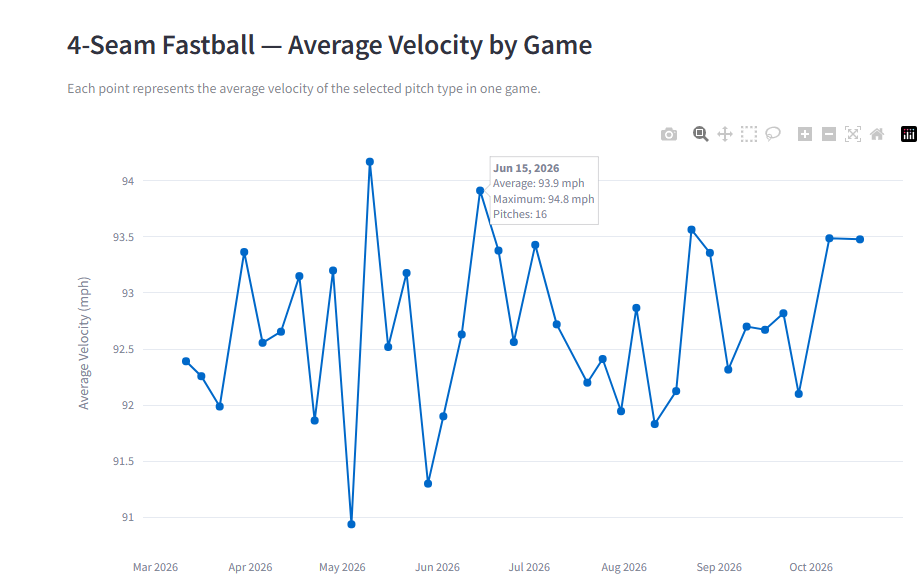
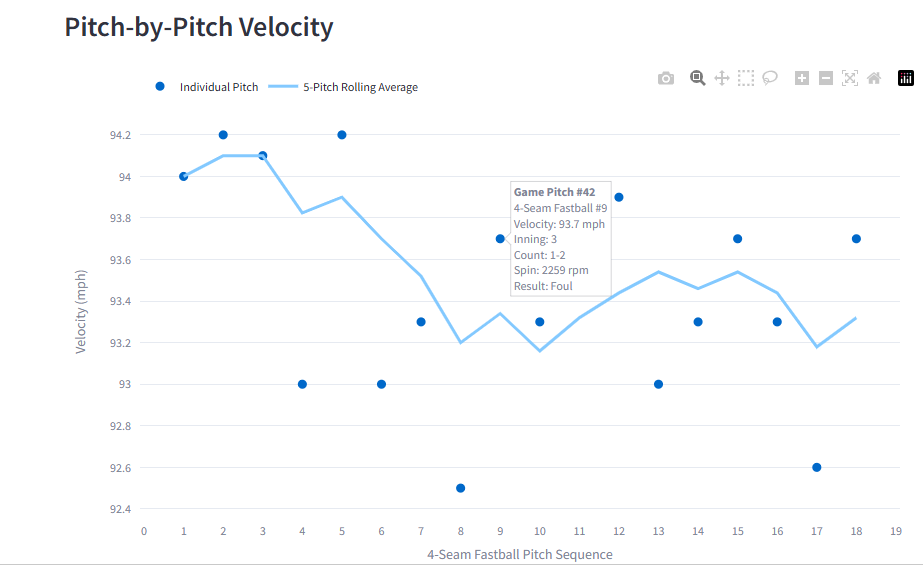
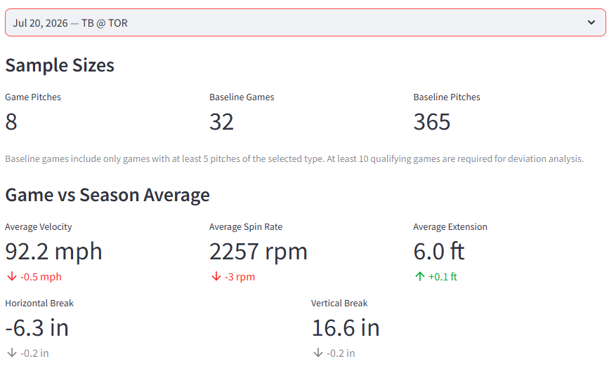

# MLB Pitching Analytics

### Interactive Statcast Pitching Analysis | Python • Streamlit • SQLite • Plotly

An interactive baseball analytics application designed to explore MLB pitcher performance through pitch-level Statcast data, season-long trends, individual game analysis, and comparisons against season baselines.

The project combines automated data retrieval, a locally maintained SQLite database, statistical analysis, and interactive visualizations in a single Streamlit application.

**Developer:** Paul Schaefer  
**Portfolio Project:** Fall 2026

### Live Application

**[Launch MLB Pitching Analytics](https://mlb-pitching-analytics.streamlit.app/)**

---

## Project Overview

MLB Pitching Analytics provides a way to investigate pitcher performance across multiple levels of detail, from an entire season to individual pitches within a game.

The application is designed around three analytical views:

1. **Season Trends** — Examine changes in pitch velocity throughout a season.
2. **Game Analysis** — Explore pitch-by-pitch velocity, rolling averages, and inning-level performance.
3. **Game vs Season Baseline** — Compare individual games against a pitcher's season averages and identify statistically notable deviations.

Users can select pitchers, seasons, pitch types, and individual games through the Streamlit interface.

## Key Features

### Player Selection and Statcast Data Retrieval

- Search for pitchers by first and last name.
- Optionally enter an MLBAM Player ID to bypass name lookup.
- Select seasons from 2022 through 2026.
- Retrieve Statcast pitching data using `pybaseball`.
- Store retrieved data in a local SQLite database.
- Refresh previously collected data using an overlapping date window to reduce duplicate records.

The database allows previously retrieved pitch-level information to be reused for subsequent analysis.

### 1. Season Trends

Analyze average velocity for a selected pitch type across individual games.

Features include:

- Game-by-game average pitch velocity.
- Maximum velocity recorded in each game.
- Pitch counts for each game.
- Interactive Plotly charts with detailed hover information.
- Expandable game summary tables.



### 2. Game Analysis

Examine pitch velocity and performance within an individual MLB game.

Features include:

- Selection of individual games and innings.
- Pitch-by-pitch velocity visualization.
- Five-pitch rolling velocity averages.
- Average, maximum, and latest pitch velocity.
- Comparison of the first and last ten pitches of the selected type.
- Average velocity by inning.
- Expandable pitch-level data tables with velocity, spin rate, count, and pitch results.



### 3. Game vs Season Baseline

Compare a pitcher's performance in a selected game against season-long pitch characteristics.

The application evaluates five measurements:

| Metric | Unit |
|---|---|
| Release Velocity | mph |
| Spin Rate | rpm |
| Release Extension | feet |
| Horizontal Movement | inches |
| Vertical Movement | inches |

The analysis displays season averages, selected-game averages, and differences between the two.



### Statistical Deviation Analysis

The application also calculates standardized deviations to help identify games where pitch characteristics differ from typical season performance.

For each pitch type:

- Game-level averages are calculated for each measurement.
- Games must contain at least five pitches of the selected type to contribute to the game-level reference distribution.
- Standard deviations are calculated from qualifying game averages.
- The selected game's average is compared against the mean of those qualifying game averages.

The standardized deviation is calculated as:

**Z-score = (Selected Game Average − Mean of Qualifying Game Averages) / Standard Deviation of Qualifying Game Averages**

Results are classified as follows:

| Absolute Z-Score | Classification |
|---|---|
| Less than 1.0 | Within Range |
| 1.0 to less than 2.0 | Notable |
| 2.0 or greater | Unusual |

At least ten qualifying baseline games and five pitches in the selected game are required for a deviation classification. Metrics without sufficient variation are reported separately.

These classifications describe statistical variation rather than automatically indicating improvements, declines, injuries, or changes in effectiveness.

---

## Technologies Used

| Technology | Purpose |
|---|---|
| Python | Data processing and application logic |
| Streamlit | Interactive web application |
| pybaseball | Statcast data retrieval and player lookup |
| Pandas | Data manipulation and statistical summaries |
| SQLite | Persistent pitch-level data storage |
| Plotly | Interactive visualizations |
| Matplotlib | Inning-level velocity charts |

## Data Source

Pitch-level data is retrieved from **MLB Statcast**, accessed through the `pybaseball` Python library.

Statcast provides measurements including:

- Pitch velocity and spin rate
- Release extension
- Horizontal and vertical pitch movement
- Pitch classification
- Game and inning information
- Pitch results and count information

Data availability depends on the underlying Statcast records and the selected player and season.

## Database Design

The application uses SQLite to maintain a database of previously retrieved Statcast pitching records.

The data workflow follows these steps:

1. The user selects a pitcher and season.
2. The application checks the SQLite database for existing records.
3. A Statcast request retrieves data for the required date range.
4. Retrieved records are stored in the database.
5. The application loads the stored data for analysis and visualization.

When refreshing existing data, a three-day overlap window is used. Existing records in the requested period are replaced before updated records are inserted.

This approach reduces unnecessary repeated downloads while allowing the database to incorporate newer Statcast information.

## Running the Application Locally

Clone the repository:

```bash
git clone https://github.com/PSchaefer82/MLB-Velocity-Tracking.git
```

Navigate into the project directory:

```bash
cd MLB-Velocity-Tracking
```

Install the required packages:

```bash
pip install -r requirements.txt
```

Launch the application:

```bash
streamlit run app.py
```

Streamlit will provide a local URL for accessing the application through a web browser.

## Project Structure

```text
MLB-Velocity-Tracking/
│
├── app.py
├── requirements.txt
├── README.md
│
├── data/
│   └── pitching_statcast.sqlite
│
└── images/
    ├── season_trends.png
    ├── game_analysis.png
    └── game_vs_season_baseline.png
```

The SQLite database is created automatically when the application runs if it does not already exist.

## Project Purpose

This project was developed as a baseball analytics portfolio application to demonstrate practical experience with:

- Retrieving and validating baseball tracking data.
- Building and maintaining a structured database.
- Developing reproducible statistical comparisons.
- Identifying meaningful changes in pitcher characteristics.
- Designing interactive visualizations for baseball analysis.
- Translating pitch-level information into accessible analytical summaries.

The broader objective is to explore how data engineering, statistical analysis, and interactive applications can support baseball research and operational decision-making.

## Future Development

Potential enhancements include:

- More advanced pitcher identification and search functionality.
- Pitch usage trends and changes in pitch mix.
- Expanded pitch movement analysis.
- Comparisons across multiple pitchers or seasons.
- Additional statistical measures and visualizations.
- More advanced data quality checks and reporting.

---

**Developed by Paul Schaefer**  
Toronto, Ontario, Canada

[GitHub Repository](https://github.com/PSchaefer82/MLB-Velocity-Tracking) | [Live Application](https://mlb-pitching-analytics.streamlit.app/)